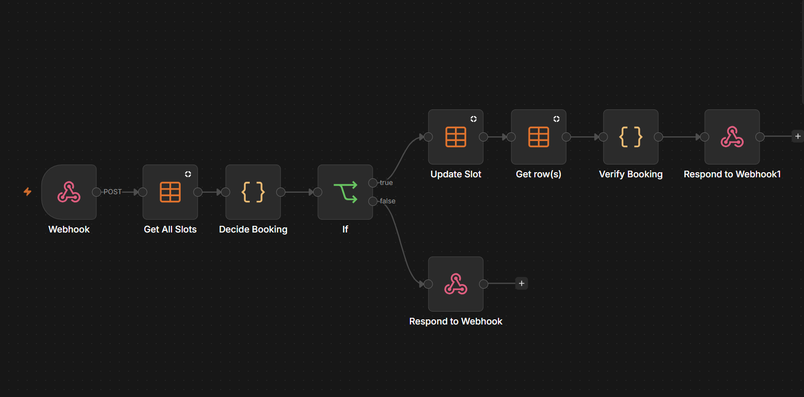
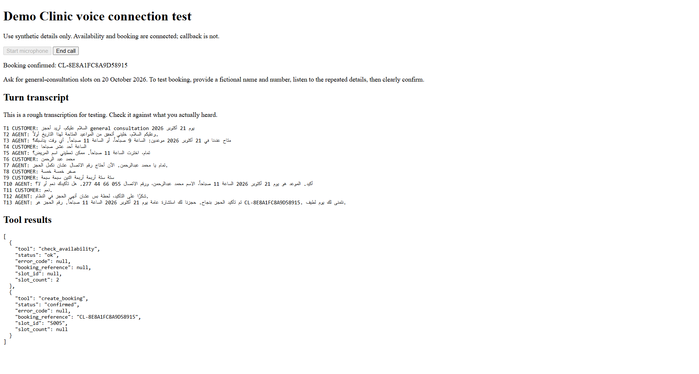

# Bilingual clinic voice receptionist (synthetic POC)

A browser microphone demo for an English/Arabic clinic receptionist. OpenAI Realtime handles the spoken conversation; a small local Node.js server proxies tool calls to n8n workflows for availability and booking. The agent checks a slot, collects a fictional name and callback number, repeats the details, requests an explicit confirmation, then announces a booking only after the booking workflow verifies its saved row. The browser shows numbered transcript turns and tool outcomes for inspection.

This uses fictional appointments and people. It is a local proof of concept, not a telephone service or a production medical booking system. Speech transcription can mishear brief Arabic confirmations; `confirmation_turn_id` is a trace pointer, not proof of consent. The n8n Data Table implementation has no transactional guarantee for simultaneous callers.

## Demo screenshots

**Workflow design:** the n8n availability and booking workflows used by the voice agent.

**Conversation result:** the local transcribing page showing a fictional call, the caller's explicit confirmation, and the returned `create_booking` result.

Add these two PNG files before publishing the README. Capture only fictional data and crop out webhook URLs, credentials, tokens, and full callback numbers.

## What is included

- `voice-probe/`: local WebRTC microphone page and Node.js proxy. The API key stays server-side.
- `agent-prompt.md` and `clinic-policy.md`: bilingual agent behavior and booking rules.
- `workflows/`: sanitized n8n exports for availability, booking, and an optional callback backend. Exports contain no credentials, account-specific table/folder IDs, or pinned run data. Rebind resources after import.
- `seed-slots.csv` and synthetic JSON requests for repeatable tests.
- JavaScript files: the Code node logic used in the corresponding n8n workflows.

## Reproduce

1. Create an n8n Data Table named `clinic_slots` with Text columns `slot_id`, `service`, `local_date`, `starts_at`, `status`, `request_id`, `booking_reference`, `patient_name`, `callback_number`, `confirmation_turn_id`, and `booked_at`. Load fictional rows from `seed-slots.csv`. Use future dates if the examples have passed.
2. Import `workflows/check-availability.json` and `workflows/create-booking.json`. Re-select `clinic_slots` in every Data Table node. Configure the Webhook nodes with the same Header Auth credential (`X-Clinic-Tool-Key`), then publish the workflows. Copy their production webhook URLs. Do not commit the token or URLs.
3. In PowerShell, from this folder, run `./start-voice.ps1`. Enter the two production URLs, webhook token, and OpenAI API key when prompted. This script starts the local server on port 3000. Open `http://127.0.0.1:3000/` in a browser and allow microphone access.
4. Ask for availability for a date in the table, choose an available slot, provide fictional details, and give a clear yes after the agent repeats the full booking. Inspect the transcript, `create_booking` result, and saved `clinic_slots` row. Retry the same request ID directly against the booking webhook to check idempotency.

`workflows/request-callback-optional.json` is a separate backend demonstration. It requires a `clinic_callbacks` table with Text columns `request_id`, `callback_reference`, `name`, `callback_number`, `administrative_reason`, `consent_turn_id`, `created_at`, and `status`. It is not exposed as a tool in the current voice page.

## Observed result and limits

In a local English call, the agent checked availability, obtained a clear confirmation, and booked slot `S002`; n8n returned `status=confirmed` with a reference, and the slot became booked. Arabic availability and conversation tests also ran. A short Arabic response was once transcribed incorrectly, so consent handling needs further audio-grounded testing. The two projects are intentionally separate at this stage; the voice transcript is not automatically submitted to the QA workflow yet.
